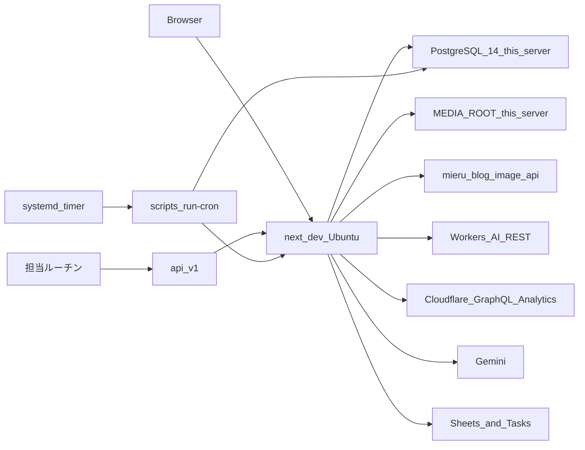

# システムアーキテクチャ

関連: [overview.md](./overview.md) · [database.md](./database.md) · [interfaces.md](./interfaces.md)

コード生成・リファクタ時に逸脱しないためのルールブック。詳細な操作手順は [README.md](../README.md)。

## 1. 全体構成図

- ブラウザは App Router の画面と Server Actions が中心。自動処理の DB 入口は `/api/v1`。閲覧画面はログイン必須。
- データベースは、このサーバーの PostgreSQL 14。画像とファイルのうち ai-org が持つものは、このサーバーの `MEDIA_ROOT`。D1 と Wrangler は実行経路に入れない。
- 公開ブログの新規サムネは、既存のブログ画像 API（`https://mieru-storage-backend.studiofoods.net/api/v1/blog_images`）のまま。公開済みの旧 R2 URL は書き換えない。見分けは `blog_posts.thumbnail_origin`（`r2` / `blog_image_api`）。
- 正の URL は `https://ai-org.studiofoods.net/`。旧 `ai-org.s-takahashi-241.workers.dev` の転送期間は `OLD_URL_REDIRECT_UNTIL`。未設定の間は転送を残す。転送の実体は公開側の設定。
- Cron は [scripts/run-cron.ts](../scripts/run-cron.ts)。Google Tasks 同期（10分）と、本番一覧との照合（`blog-reconcile`、1時間）。X API 投稿 Cron は no-op。

## 2. 技術スタック

- **Frontend**: Next.js 16 App Router、React 19、Tailwind CSS 4、TypeScript 5。会計マニュアルのフロー図はクライアントで mermaid 11.6.0（jsDelivr ESM）を SVG 描画する
- **Backend**: 同じ Next.js（Server Actions + Route Handlers）。別言語の API サーバはない
- **Hosting**: outside-local-ubuntu の `/home/s-takahashi/development/ai-org` で `next dev`（`127.0.0.1:3080`）。外向きは Cloudflare Tunnel `https://ai-org.studiofoods.net`（pm2 `ai-org-cloudflared`）。Tunnel 経由の開発時 HMR は `next.config.ts` の `allowedDevOrigins` で公開ホストを許可する。手順は [deploy/ubuntu/README.md](../deploy/ubuntu/README.md)
- **DB**: このサーバーの PostgreSQL 14（`DATABASE_URL`、database `ai-org`）。MIERU 側の DB とは分ける。ORM なし、生 SQL。呼び出しは D1 形のアダプタ（[src/lib/pg-db.ts](../src/lib/pg-db.ts)）
- **画像**: ai-org のファイルはローカルディスク（`MEDIA_ROOT`、既定 `data/media`）。キーは `x-posts/` `tasks/` `blog-posts/`。公開ブログの新規画像は別ホストのブログ画像 API。キーは共有しない
- **Auth**: 画面はアプリ内パスワード + `jose` HS256 JWT Cookie（`ai-org-session`）。`/api/v1` は `X-API-Key`。`API_KEYS` が空なら `AUTOMATION_INGEST_SECRET` を admin として受け付ける。推奨は担当ごとのキー（`名前|role|secret` をカンマ区切り）
- **AI**: Workers AI の REST API（文字起こし。`CF_ACCOUNT_ID` と `CF_API_TOKEN`）、Gemini（X 投稿画像解析）
- **分析**: Cloudflare GraphQL Analytics（`/web-analytics`。`CF_API_TOKEN` に Zone Read + Analytics Read。任意で `CF_ANALYTICS_ZONE_NAMES`）
- **外部**: Google Sheets、Google Tasks、X API（Cron からは未使用）。OpenClaw Control UI は ai-org から HTTP リダイレクトのみ（`OPENCLAW_CONTROL_UI_URL`）。トンネル・認証は OpenClaw 側の Cloudflare 構成に依存し、ai-org はプロキシしない

設定はリポジトリの `.env`。KV / Queues / Durable Objects / Vectorize は使っていない。D1 と R2 は過去の移行元で、実行時には使わない。

## 4. `/api/v1`

ベース URL は `https://ai-org.studiofoods.net/api/v1`。パスは `/api/v1` で固定する。HTTP API の正本は [api-rules.md](./api-rules.md)（画面 `/api-rules`、`GET /api/v1/spec`）。画面ルートと Server Actions は [interfaces.md](./interfaces.md)。

- 書き込みは同じ ID の upsert。記事の同一性は slug。差戻し済みの slug での新規登録は 409 `slug_rejected_exists`。draft 以外の本文更新は 403。
- 状態は `draft → approved → published`。`published` から戻すのは admin の `force=true`、または画面での昌兵さんの操作。戻したときは通知する。
- 承認前の自動チェック（`file://`、タイトルの `【】`、slug、カテゴリ、出典のない数字、許可外リンク）は `BLOG_PREAPPROVE_CHECKS` が `0` でなければ有効。リンクの許可は `studiofoods.net` のお問い合わせ、ブログ、サービス。
- 未解決コメント（DB の `open`。API 上の名前は `resolved`、保存値は従来の `done`）が残る記事は承認できない。批評のコメントも `blog_post_comments` に入れる。
- ブランド承認・記事チェック・昌兵さんの要判断までを公開条件にするかは `BLOG_PUBLISH_GATE=1` のときだけ。既定はオフ。
- 本文の正本は PostgreSQL。X 投稿とブログネタも同じ。X の更新は `base_updated_at` が古いと 409。
- 失敗、認証エラー、0 件取り込み、照合の差は `ops_alerts` に残り、`/board` に出る。任意で `ALERT_WEBHOOK_URL`。
- ロールは `reader` / `reviewer` / `writer` / `publisher` / `admin`。reviewer はコメントと判定のみ。writer は draft の本文。publisher は状態と業務台帳。admin は全操作。

## 3. 設計方針・コーディング規約

### ディレクトリ構造の役割

| パス | 役割 |
|---|---|
| `src/app/` | 画面、`actions.ts`（`"use server"`）、`api/` |
| `src/components/` | UI。Server Action を呼ぶ Client Components |
| `src/lib/` | PostgreSQL / ローカル画像、認証、同期、型、自動化カタログ |
| `src/middleware.ts` | セッション検証。localhost はスキップ |
| `scripts/run-cron.ts` | systemd timer から呼ぶ定期実行 |
| `migrations/pg/` | PostgreSQL 14 スキーマの正本 |
| `migrations/` | 旧 D1（SQLite）マイグレーション。適用しない |
| `docs/` | 仕様書。`VERSION.md` は変更履歴（別ルール） |

### 状態管理の原則

- Redux / Zustand / TanStack Query は使わない。
- 読み取り: RSC が Server Actions を呼び、props で Client へ渡す。
- 書き込み: `"use server"` + `useTransition`。更新後は `revalidatePath`。
- ページは `dynamic = "force-dynamic"` を前提にする。
- DB は `getDb()`（[src/lib/db.ts](../src/lib/db.ts)）。設定は `getAppEnv()`。ID は `prefix_uuid`。

### エラーハンドリング・ロギング

- ユーザー向けは `{ error: string }` または HTTP 500。詳細は `console.error`。
- ルートエラー境界は `src/app/error.tsx`。
- Cron の成否は `recordAutomationRun` で PostgreSQL に残す。
- 集中ログ基盤（Sentry 等）は導入しない（現状維持）。

### 逸脱禁止（承認なしでやらない）

- Prisma / Drizzle など ORM の追加。
- Cloudflare Access との二重認証。
- KV / Durable Objects / Queues の無断追加。
- 公開会員登録・Stripe 課金など、社内ツールから外れる認証・課金モデル。
- UI/CSS（レイアウト、色、フォント、間隔）の無断変更。
