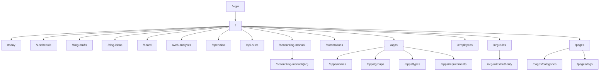

# インターフェース仕様

関連: [overview.md](./overview.md) · [architecture.md](./architecture.md) · [database.md](./database.md)

OpenAPI / Swagger は無い。画面は App Router、更新の大半は Server Actions（[src/app/actions.ts](../src/app/actions.ts)）。

## 1. 画面一覧・遷移フロー

ナビ正本は [src/lib/app-nav.ts](../src/lib/app-nav.ts)。`/login`、`/privacy`、`/terms`、および未ログインの `/` ではトップナビを出さない。ログイン後の画面では出す。トップレベルは「業務台帳」の次に「今日のタスク」（`/today`）。「投稿」はドロップダウン（サイドメニューでは見出し）で、小要素はブログ下書き・ネタ・X投稿スケジュール。「情報」はドロップダウン（サイドメニューでは見出し）で、小要素は掲示板・Web分析・OpenClaw・API ルール・会計マニュアル。「組織」はドロップダウン（サイドメニューでは見出し）で、小要素は従業員・組織ルール・自動化一覧。

| パス | 画面 | ナビ |
|---|---|---|
| `/login` | パスワードログイン。利用規約とプライバシーポリシーへのリンクあり | なし |
| `/privacy` | プライバシーポリシー。未ログインで公開。取得する情報、利用目的、保存、第三者提供、Google Tasks の Limited Use を記載。公開 URL は `https://ai-org.studiofoods.net/privacy` | なし |
| `/terms` | 利用規約。未ログインで公開。公開 URL は `https://ai-org.studiofoods.net/terms` | なし |
| `/` | 未ログインではアプリの説明（目的、主な機能、Google Tasks で扱うデータ、プライバシーポリシーと利用規約へのリンク）。ログイン後は業務台帳（カレンダー / ガント / 看板）。タスク追加・編集のタグは名前で検索して絞り込める。検索に一致しない選択中タグは残る。Google Tasks OAuth callback（`?code=`）もここ。未ログインの callback は `/login?next=` へ | 未ログインはなし。ログイン後はトップ |
| `/today` | 今日のタスク。業務台帳から、期間が今日（日本時間）を含むタスクと、期間の終わりが昨日以前で未完了のタスクを出す。下書きは含めない。未完了行の「完了」で `tasks.status` を `done` にする（Google Tasks 同期も既存の完了処理に乗る） | トップ |
| `/x-schedule` | X投稿スケジュール（タブ: @MIERUagri_漫画 / @MIERUagri / @MIERUkaikei / @MIERUkaikei_漫画 / @studio_foods）。一覧のステータスは全候補をボタン表示し、ワンクリックで更新。投稿済以外の記事の AI コメント確認（未対応／対応済） | トップ（投稿） |
| `/blog-drafts` | ブログ下書きの確認・承認。一覧表に使用予定画像（TOP / 図表）を表示。確認ポップアップは本文中のインライン SVG を画像として表示。未公開記事の AI コメント確認（未対応／対応済）。Sheets 双方向同期はデフォルト無効（環境変数 `BLOG_DRAFTS_SHEET_AUTO_SYNC=1` で有効化）。notes に「本番へは出さない」を含む行は同期時の削除から保護 | トップ（投稿） |
| `/blog-ideas` | ネタの CSV アップロードと参照（タブ: SideBusiness / Agri / 税務 / DX / 業務プロセス改革 / M＆A / 労務 / 3社比較）。一覧の「下書き」列に、未転用 / ブログ下書き / X下書き / 両方を出す。各ネタの転用先（ブログ / X の媒体）とタグ（ページ台帳と同じマスタ）を記録。SideBusiness タブは一覧の上に4象限（縦: 副業時の月収レンジ中央値、横: 参入難易度）を出し、点のクリックで詳細ダイアログを開く | トップ（投稿） |
| `/board` | 掲示板（投稿管理シートのリンク、VERSION 履歴） | トップ（情報） |
| `/web-analytics` | Cloudflare ゾーンの HTTP トラフィック（リクエスト・ページビュー・転送量、直近 7 / 14 / 28 日） | トップ（情報） |
| `/openclaw` | OpenClaw Control UI へリダイレクト。`OPENCLAW_CONTROL_UI_URL` 未設定時は設定手順を表示 | トップ（情報） |
| `/api-rules` | HTTP API ルール（`docs/api-rules.md` と同期。ボットは `GET /api/v1/rules` または `/spec`） | トップ（情報） |
| `/accounting-manual` | 会計マニュアル目次（法人税決算・申告 No.1〜62） | トップ（情報） |
| `/accounting-manual/[no]` | 会計マニュアルの各項目（No.1〜62）。前後の項目と目次へ移動可 | 情報 |
| `/automations` | 自動化カタログ / Spark / App Cron | トップ（組織） |
| `/apps` | App リスト | トップ（App管理） |
| `/apps/names` | App 名マスタ | App サブタブ |
| `/apps/groups` | AppGroup マスタ | App サブタブ |
| `/apps/types` | AppType マスタ | App サブタブ |
| `/apps/requirements` | App 要件定義 | App サブタブ |
| `/apps/test-results` | App テスト計画・テスト結果 | App サブタブ |
| `/employees` | AI従業員マスタ | トップ（組織） |
| `/org-rules` | 組織ルール一覧 | トップ（組織） |
| `/org-rules/authority` | 職務権限表 | 組織ルール サブタブ |
| `/pages` | ページ台帳 | トップ |
| `/pages/categories` | カテゴリマスタ | ページ サブタブ |
| `/pages/tags` | タグマスタ | ページ サブタブ |
| `/task-groups` | タスクグループマスタ | ナビ外 |
| `/categories` | `/pages/categories` へリダイレクト | — |
| `/tags` | `/pages/tags` へリダイレクト | — |

ログアウトは `/api/auth/logout`。

### 権限ごとのアクセス制御

ロール別 ACL はない。社内共有パスワード 1 本。

- **本番ホスト**: JWT Cookie `ai-org-session`（httpOnly、SameSite=lax、最大 30 日）。未ログインは `/login?next=…`。未ログインの `/`、`/privacy`、`/terms` はセッション不要で、認証シークレット未設定でも 500 にしない。`/?code=` と `/?error=` はセッションが必要。
- **localhost / 127.0.0.1**（`Host` ヘッダーが上記のとき）: 認証スキップ（[src/middleware.ts](../src/middleware.ts)）。Cloudflare Tunnel 経由の `https://ai-org.studiofoods.net` は `Host` が公開名になるため認証が有効。
- **HTTP API の詳細**（認証・エンドポイント一覧）: [api-rules.md](./api-rules.md)。画面は `/api-rules`、ボットは `GET /api/v1/rules`（HTML 既定）または `GET /api/v1/spec`（JSON 既定、`Accept: text/markdown` 可）。
- **`/api/internal/*`**: セッション対象外。ingest secret（上記 api-rules）。新規の自動処理は `/api/v1` を使う。
- **`/api/v1/*`**: セッション対象外。`X-API-Key` とロール（上記 api-rules）。
- 認証シークレット未設定の本番は 500（`Auth configuration missing`）。
- Cloudflare Access は使わない（二重認証になる）。

## 2. API仕様

HTTP API（Route Handler・`/api/v1`）の正本は [api-rules.md](./api-rules.md)。アプリ内 **情報 → API ルール**（`/api-rules`）、または `GET /api/v1/rules` / `GET /api/v1/spec`（`X-API-Key`、`reader` 以上）で同内容を取得できる。

### Server Actions（要約）

正本は [src/app/actions.ts](../src/app/actions.ts)。ネタのアップロード・転用先・タグは [src/app/blog-ideas/actions.ts](../src/app/blog-ideas/actions.ts)。

| ドメイン | 主な操作 |
|---|---|
| Employees / Categories / Tags / Task groups / Pages | list / create / update / delete（Employees は reorder あり） |
| Org rules | list / get / create / update / body 更新 / delete |
| Tasks | list / create / update / status / delete |
| X posts | list / create / update / status / delete / Sheets 同期 / 予約分投稿 / 即時投稿 / コメント一覧・対応状況 |
| Google Tasks | 今すぐ同期 / 最終実行の取得 / OAuth 完了（全リスト取得、新規はリスト ai-org） |
| Spark | シートから再取得 |
| App names / groups / types / apps / crons / requirements | list / create / update / reorder / delete |
| App test plans / test results | 画面: list / save plan / create / update / delete。ボット: `/api/v1` の `apps/test-plans`・`apps/test-results` |
| Blog | list / create / update / status / delete / コメント一覧・対応状況 / 投稿先シート同期 |
| ネタ | list / CSV アップロード / 転用先（ブログ・X の媒体）の付与と解除 / タグの付与・解除・新規追加 |

即時 X 投稿や「予約分をいま投稿」は Server Action から呼べるが、毎分 Cron（systemd timer）の X API 投稿は停止中。
